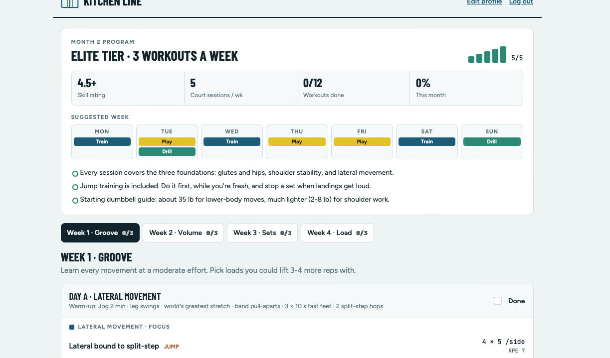

# Kitchen Line API

Backend for **Kitchen Line**, a pickleball strength and movement app. A player answers six questions (age, gender, skill rating, drill sessions, games played and workouts wanted per week), and the server builds a personalized **4-week progressive-overload program** that gets harder month after month.

**Front end:** [kitchenline-web](https://github.com/mranda88/kitchenline-web)
**Live demo:** _coming soon_



---

## Features

- **Personalized programs.** Intensity is set from skill rating and age: higher skill and younger age mean more volume, heavier loads and jump training.
- **Pickleball-specific foundations.** Every workout covers glute and hip strength, shoulder stability and lateral movement, plus paddle power and core work.
- **Progressive overload.** Week 1 grooves the movements, week 2 adds reps, week 3 adds a set and week 4 adds load. The tier steps up every two months, capped by age.
- **Safety rules built in.** No jump training for players 55 and over, set caps for players 60 and over, and reduced leg volume for players with heavy court schedules.
- **Progress tracking.** Players check off workouts. Finishing 75% of a month unlocks the next one, built from their latest profile.
- **Accounts.** Sign-up, login and logout with secure session cookies.

## Tech stack

Java 21 · Spring Boot 4.1 · Spring Security · Spring Data JPA / Hibernate · MySQL · JUnit 5 · Maven

## How the program engine works

The engine lives in `engine/` and is plain Java with no framework dependencies, so it is fast to unit test.

**1. Intensity tier (1–5).** Skill (1–5) is multiplied by an age factor and rounded, then capped by age.

| Age | Factor | Max tier |
|---|---|---|
| under 30 | 1.1 | 5 |
| 30–39 | 1.0 | 5 |
| 40–49 | 0.9 | 5 |
| 50–59 | 0.8 | 5 |
| 60–69 | 0.7 | 4 |
| 70+ | 0.6 | 3 |

**2. Exercise selection.** 37 exercises across 4 categories, each with a minimum tier. A block keeps only what the tier unlocks, allows at most one jump exercise, and rotates by day so Day A and Day B differ. Exercises stay fixed for the month, so the player can measure progress on the same movements.

**3. Weekly dose.**

| | Week 1 | Week 2 | Week 3 | Week 4 |
|---|---|---|---|---|
| Sets | base | base | +1 | +1 |
| Reps | base | +2 | +2 | +2 |
| Timed holds | base | +5 s | +5 s | +10 s |
| Load | start | start | start | +10% |
| Target RPE | 6 | 7 | 7 | 8 |

## Architecture

```
controller/   REST endpoints: read the request, call a service, return JSON
service/      Business rules: access, progress, 75% unlock, profile snapshots
engine/       Program generator, tier calculator, exercise library (pure Java)
domain/       JPA entities: users, player_profiles, program_months, workout_logs
repository/   Spring Data interfaces (queries derived from method names)
security/     Spring Security config, session login, CSRF, user lookup
```

## Security

- Passwords stored as **BCrypt** hashes, never in plain text.
- Session cookie is **HttpOnly** and **SameSite=Lax**. The session ID is regenerated at login to prevent session fixation.
- **CSRF protection** for the single-page app: the token is sent in the `XSRF-TOKEN` cookie and checked against the `X-XSRF-TOKEN` header on every change.
- Login errors don't reveal whether an email has an account.
- Every endpoint takes the user from the session, never from the request, so one player can't read or change another player's data.
- Access rules run on the server: content a player can't access is never sent to the browser.

## API

| Method | Path | Description |
|---|---|---|
| POST | `/api/auth/signup` | Create an account |
| POST | `/api/auth/login` | Log in (starts a session) |
| POST | `/api/auth/logout` | Log out |
| GET | `/api/auth/me` | Current account |
| GET | `/api/profile` | Saved profile answers |
| PUT | `/api/profile` | Save profile (the first save starts Month 1) |
| GET | `/api/program/current` | This month's program and progress |
| POST | `/api/program/workouts/{week}/{day}` | Mark a workout done |
| DELETE | `/api/program/workouts/{week}/{day}` | Un-mark a workout |
| POST | `/api/program/next-month` | Start the next month (needs 75% done) |

## Running locally

**Requirements:** Java 21+, MySQL 8+

1. Create the database and user:
```sql
   CREATE DATABASE kitchenline;
   CREATE USER 'kl_app'@'localhost' IDENTIFIED BY 'choose-a-password';
   GRANT ALL PRIVILEGES ON kitchenline.* TO 'kl_app'@'localhost';
```
2. Create `local.properties` in the project root (it is git-ignored):
```properties
   DB_PASSWORD=choose-a-password
```
3. Run the app:
```bash
   ./mvnw spring-boot:run
```
   Check it at http://localhost:8080/api/health

## Testing

```bash
./mvnw test                  # 51 tests
./scripts/smoke-test.sh      # 20-step API journey against the running app
```

- **Engine unit tests:** tier rules, overload by week, age safety rules, and every combination of skill × age × workouts × month.
- **Repository tests:** queries and database constraints against MySQL, rolled back after each test.
- **Service tests:** profile snapshots, the 75% unlock, and access rules with the paywall both on and off.
- **Authentication tests:** password hashing, login and generic error messages.

## Design decisions

- **Store inputs, not generated workouts.** Each month saves a snapshot of the profile and the month number, and the generator rebuilds the program on request. That keeps the database small and the output consistent.
- **Profile snapshot per month.** Editing a profile mid-month doesn't reshuffle the current program. Changes take effect next month, or right away if no workout has been logged yet.
- **Rules in the service layer.** Controllers stay thin, so any future client (such as a mobile app) gets the same rules.
- **Paywall behind a flag.** `app.paywall-enabled` switches between free mode (current) and a trial/membership model. Both modes are covered by tests.

## Roadmap

- Stripe subscriptions (membership model already supported behind the flag)
- Database migrations with Flyway
- Exercise demo videos
- Exercise library review by a licensed physical therapist
